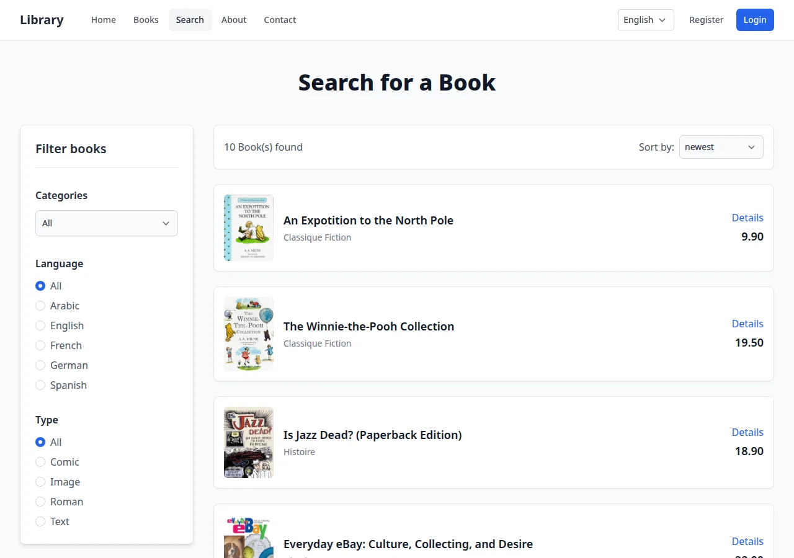
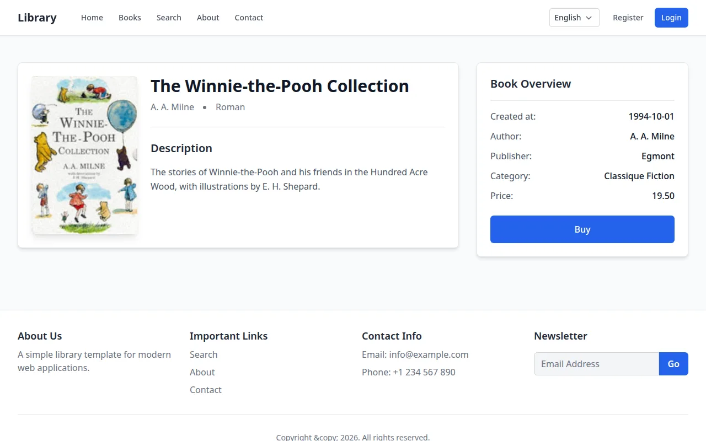
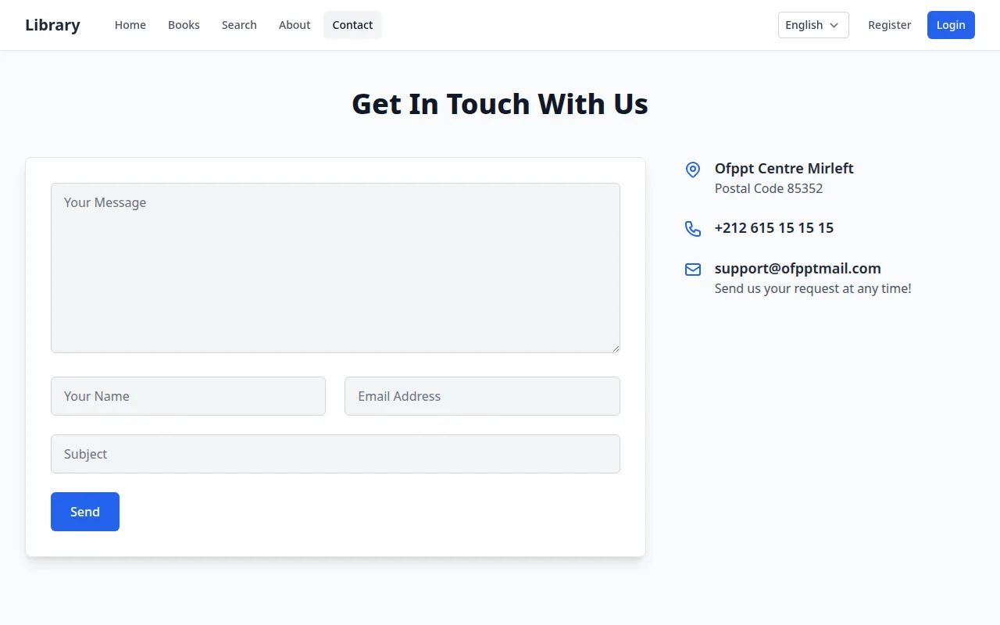

# Library Management System

An online library catalogue built with Laravel, as a portfolio project. Visitors browse and search the books, filter them by category, language and type, and read each book's details. Admins add, edit and delete books from the same pages. A token-protected REST API serves the same catalogue to other apps.

The site is in English, French and Arabic (with a right-to-left layout for Arabic), and it works on phones as well as on large screens.

**Live demo:** coming soon


> This is a demo catalogue. The books and covers come from the seeder, the prices are invented, and the "Buy" button does nothing. The book titles and cover images belong to their publishers.

## Features

**The catalogue**

- A home page with a search box that looks up books by title or author.
- A grid of all the books with their covers, and a page for each book with its details.
- A search page (Livewire) that filters by category, language and type and sorts by date, title, price or author, without reloading the page.
- English, French and Arabic, chosen from the language menu in the header. Arabic switches the whole layout to right-to-left.
- A layout for phones: a menu button in the header, filters that fold away, and a two-column book grid.

**Accounts and admin**

- Registration, login, password reset and e-mail verification.
- Two roles. Regular users can read the catalogue and e-mail themselves a book's details. Admins can also create, edit and delete books, with a cover upload, categories, a language and a type.
- Every change to a book is recorded in an activity log.
- Console commands to create, list, show, promote and delete users.

**The API**

- A REST API under `/api` with Sanctum bearer tokens.
- Logging in is limited to 5 attempts a minute, and tokens expire after 7 days by default.
- Paginated book lists (up to 100 per page). Only admins can create, update or delete.
- 88 feature tests (Pest).

## Screenshots

| Books | Search and filters |
|---|---|
|  |  |
| **One book** | **Contact** |
|  |  |

On phones:


## Tech stack

| Part | Built with |
|---|---|
| Backend | PHP 8.4+, Laravel 12, Livewire 4, Laravel Sanctum 4 |
| Frontend | Blade, Tailwind CSS 3, Alpine.js (bundled with Livewire), Vite 7 |
| Database | SQLite, MySQL or PostgreSQL |
| Tests and tools | Pest 4, Laravel Pint, ESLint, Prettier, GitHub Actions |

## How it's organised

```
app/                Controllers, models, policies, the Livewire filter, services and console commands
database/           Migrations, factories and seeders (the demo books live in BookSeeder)
lang/               English, French and Arabic translations
resources/views/    Blade pages, the Livewire view and the shared header and footer
public/covers/      The demo book covers and the "no cover" placeholder
routes/             Web, API and auth routes
tests/Feature/      The Pest test suite
docs/screenshots/   The screenshots in this README
```

## Run it on your computer

You need PHP 8.4 or newer (with `pdo_sqlite`), Composer 2, and Node.js 22 or newer.

**1. Install**

```bash
composer install
cp .env.example .env           # uses SQLite and logs e-mails instead of sending them
php artisan key:generate
touch database/database.sqlite
```

**2. Create the database and the demo data**

```bash
php artisan migrate --seed     # categories, languages, types, 10 demo books and a demo admin
php artisan storage:link       # makes uploaded covers reachable
```

In the `local` environment, the seeder adds 10 books whose covers are in `public/covers`, and an admin account: **admin@example.com** / **password**. You can run `php artisan db:seed --class=BookSeeder` again at any time. It updates the same 10 books and doesn't make copies.

**3. Start it**

```bash
npm ci
composer dev                   # the web server, queue worker, logs and Vite together
```

Open **http://127.0.0.1:8000**.

**Checks**

```bash
composer test                  # Pest
composer lint                  # Pint
npm run lint                   # ESLint
npm run format:check           # Prettier
```

GitHub Actions runs all of these on every push and pull request to `main`.

## Roles

Registering creates a regular user. Only admins can manage books.

```bash
php artisan users:create --admin                        # create an admin, step by step
php artisan users:promote someone@example.com           # make an existing user an admin
php artisan users:promote someone@example.com --demote  # take the admin role away
php artisan users:list
```

## API

Log in to get a token, then send it as `Authorization: Bearer <token>`.

| Method | Endpoint | Who |
|---|---|---|
| POST | `/api/login` (`email`, `password`, optional `device_name`) | anyone (5 requests a minute) |
| POST | `/api/logout` | token holder |
| GET | `/api/user` | token holder |
| GET | `/api/books?per_page=15` | token holder (paginated, 100 per page at most) |
| GET | `/api/books/{id}` | token holder |
| POST / PUT / DELETE | `/api/books[/{id}]` | admin |

Tokens expire after `SANCTUM_EXPIRATION` minutes (7 days by default). The scheduler deletes expired tokens every day.

## Production

1. Set the environment:
   - `APP_ENV=production`, `APP_DEBUG=false`, `APP_URL=https://…` and a generated `APP_KEY`
   - a real database (MySQL or PostgreSQL handle many writes at once better than SQLite)
   - `MAIL_*` for a real mailer
   - `TRUSTED_PROXIES` when the app runs behind a load balancer or reverse proxy
   - `LOG_LEVEL=warning` or `error`
2. Install and build:
   ```bash
   composer install --no-dev --optimize-autoloader
   npm ci && npm run build
   php artisan migrate --force
   php artisan db:seed --force    # only the categories, languages and types; no demo books or users
   php artisan storage:link
   php artisan optimize           # caches the config, routes, views and events
   ```
3. Create the first admin with `php artisan users:create --admin`.
4. Keep two background processes running:
   - a queue worker, `php artisan queue:work --tries=3` (the book e-mail is queued), with Supervisor or systemd
   - the scheduler, `* * * * * php artisan schedule:run` in cron
5. Point the web server at `public/`. The health check is at `/up`.

In production the app forces HTTPS links, sends HSTS on secure requests, asks for stronger passwords (10 characters or more, with upper and lower case and numbers), and refuses destructive database commands such as `migrate:fresh`.

[PRODUCTION_AUDIT.md](PRODUCTION_AUDIT.md) lists the issues that were found and fixed.
